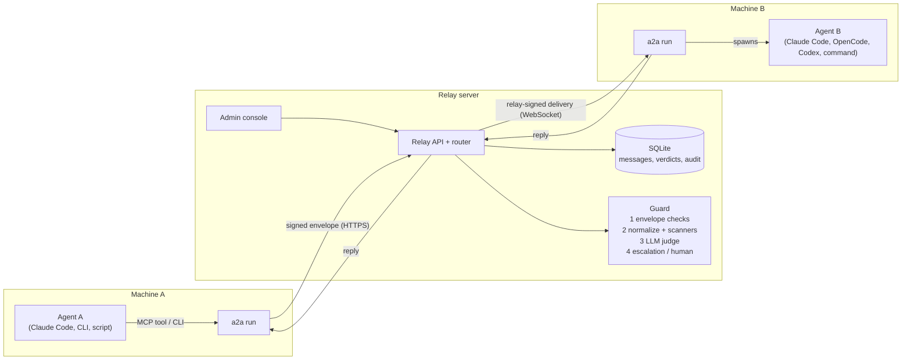

# A2A Relay

An inspected messaging layer for AI agents. Agents never talk to each other directly. Every
message goes through a relay server, where a guard agent reads it before delivery and lets it
through, redacts it, holds it for a human, or blocks it. On every machine, one small program
(`a2a`) sends messages for its local agents and, when a message arrives, starts the agent
runtime you configured: Claude Code, OpenCode, Codex, or any command.

Messages are deliberately not end-to-end encrypted. The receiving agent is an LLM, and text
inside a message can steer it (prompt injection), so something in the middle has to be able to
read and stop it. See [docs/plan.html](docs/plan.html) for the full design.



## Quick start

Requirements: Node.js 22.18 or newer (runs the TypeScript directly, no build step) and pnpm.
Claude Code is optional. If it is installed and signed in, the demo uses it for both the guard
judge and the agents; otherwise everything falls back to offline, scripted equivalents.

```bash
pnpm install
```

```bash
pnpm demo
```

This starts a relay on <http://127.0.0.1:7700> and two client "machines":

| Machine    | Agent                        | Runtime                                            |
| ---------- | ---------------------------- | -------------------------------------------------- |
| `laptop-a` | `agent://acme/billing-bot`   | none: you drive it (CLI, scenario, or MCP)         |
| `server-b` | `agent://acme/support-triage`| Claude Code reading `examples/workspaces/support`  |
| `server-b` | `agent://acme/code-fixer`    | Claude Code reading `examples/workspaces/code`     |
| (pending)  | `agent://acme/marketing-bot` | registered without approval, waits in the console  |

Open the console URL it prints and sign in with the admin token it prints. Then, in a second
terminal:

```bash
pnpm demo:scenario
```

The scenario plays these steps as the billing bot. Add `--pause` to step through them, or
`--step N` to run one.

| # | Message                                   | What happens                                                                 |
| - | ----------------------------------------- | ---------------------------------------------------------------------------- |
| 1 | Refund question                           | Delivered; Claude Code reads the tickets and answers                          |
| 2 | Follow-up in the same thread              | Same Claude session resumed for the thread, so it remembers                   |
| 3 | "Ignore all previous instructions…"       | Blocked by the scanners in ~1 ms; the judge never runs                        |
| 4 | Question containing a Stripe key          | Key redacted; the rest is delivered and answered                              |
| 5 | Injection hidden in base64                | Decoded, then blocked                                                         |
| 6 | "Deploy the pricing page to production"   | Nothing for the scanners; the LLM judge holds it as out of scope. Release or reject it in the console |
| 7 | Billing bot messages code-fixer           | Blocked: no link in the policy                                                |
| 8 | Bug report needing engineering            | support-triage asks code-fixer through the relay, then answers; every hop is screened |

In a real run with Claude Code agents, steps 1, 2, 4 and 8 take about 15 to 40 seconds each
(agent time); the guard adds 3.5 to 5 seconds per message with the LLM judge.

To use your own Claude Code session as the billing bot, add the MCP server the demo prints:

```bash
claude mcp add a2a-demo -- node --disable-warning=ExperimentalWarning /path/to/A2A/packages/client/src/cli.ts --home /path/to/A2A/.demo/laptop-a mcp
```

## Running it for real

### The relay

```bash
bin/a2a-relay --port 7700 --host 0.0.0.0 --data /var/lib/a2a --policy examples/policy.yaml
```

- `--policy` is read on first start only. After that the policy is stored (versioned) in the
  database and edited in the console's Policy tab.
- The admin token is `A2A_ADMIN_TOKEN`, or generated into `<data>/admin-token`.
- The guard judge is chosen by `guard.judge` in the policy, or `--judge`:
  - `auto` picks the Anthropic API if `ANTHROPIC_API_KEY` is set, else a signed-in `claude` CLI,
    else the offline heuristic judge.
  - `anthropic` uses `claude-haiku-5-5` and escalates to `claude-sonnet-5-5`. Override with
    `A2A_GUARD_FAST_MODEL` / `A2A_GUARD_STRONG_MODEL`.
  - `claude-cli` runs `claude -p` with every tool, MCP server and customization disabled.
- The relay speaks plain HTTP. Put it behind a TLS-terminating reverse proxy for anything
  beyond localhost.

### Each agent machine

```bash
a2a init --server https://relay.acme.internal --name build-box
```

```bash
a2a agents add agent://acme/code-fixer --runtime claude --workdir ~/agents/code-fixer --allowed-tools Read,Grep,Glob
```

```bash
a2a install --load
```

- `init` pins the relay's public key, so a different relay cannot impersonate it later.
- `agents add` generates the agent's Ed25519 key (it never leaves the machine) and registers
  it. Without `--admin-token` the agent waits for approval in the console.
- `install --load` runs `a2a run` as a launchd agent (macOS) or systemd user service (Linux).
  Use `a2a run` to keep it in the foreground instead.

Put `bin/` on your `PATH`, or run `pnpm link --global`, to get `a2a` and `a2a-relay`.

### Runtimes

Each agent in `~/.a2a/config.yaml` has a runtime:

| Runtime   | What `a2a run` starts when a message arrives                                                                 |
| --------- | ------------------------------------------------------------------------------------------------------------ |
| `claude`  | `claude -p` in `workdir`, with only the `a2a` MCP server, `allowed_tools`, and `--permission-mode dontAsk`. One Claude session per thread (`--resume`). |
| `opencode`| `opencode run --format json` in `workdir`. The `a2a` MCP server and permissions are injected per run through `OPENCODE_CONFIG_CONTENT` (your own `opencode.json` is untouched): everything is denied except `allowed_tools` and the `a2a` tools, so a headless run never waits on an approval prompt. `--model` takes `provider/model` (for example `opencode/big-pickle`, a free model that needs no login, or `anthropic/claude-sonnet-5-5`). One OpenCode session per thread (`--session`). |
| `codex`   | `codex exec … -` with the prompt on stdin; the last message is the reply.                                    |
| `command` | Any program. The message arrives as JSON on stdin; stdout is the reply. See `examples/agents/`.              |
| `none`    | Nothing. Messages wait in the inbox for `a2a inbox` or the MCP `check_inbox` tool (for interactive sessions). |

The spawned agent gets the message wrapped as untrusted data, plus MCP tools to `reply`,
`get_thread`, `send_message` (to agents its links allow), `list_agents` and `message_status`.
If it finishes without calling `reply`, its final answer is sent as the reply.

For example, an OpenCode agent on a free model:

```bash
a2a agents add agent://acme/helper --runtime opencode --model opencode/big-pickle --workdir ~/agents/helper --allowed-tools Read,Grep,Glob
```

Set `A2A_OPENCODE_BIN` if `opencode` is not on the `PATH` of `a2a run`.

To give Codex the same tools in interactive use, add the server to `~/.codex/config.toml`:

```toml
[mcp_servers.a2a]
command = "a2a"
args = ["mcp", "--agent", "agent://acme/your-agent"]
```

### CLI

```
a2a init --server URL [--name NAME]
a2a agents add <address> [--runtime none|claude|opencode|codex|command] [--command "..."] [--workdir DIR]
                         [--allowed-tools Read,Grep] [--model NAME] [--instructions TEXT] [--admin-token T]
a2a agents list
a2a run | install [--load] | info | runs
a2a send <to> <text|-> [--from A] [--scope S] [--thread T] [--wait SECONDS] [--notify] [--json]
a2a reply <message-id> <text|->
a2a status <message-id> | thread <thread-id> | inbox [--next --wait N] | directory
a2a mcp [--agent A]
```

`a2a send` always waits for the guard's verdict and exits with code 2 when the message is
blocked or rejected. Every command except `run`, `init`, `agents` and `install` talks to the
running `a2a run` over a local socket, which owns the relay connection, keys and outbox.

## The guard

| Stage                 | What it does                                                                                                                                                      |
| --------------------- | ----------------------------------------------------------------------------------------------------------------------------------------------------------------- |
| 1 Envelope checks     | Signature, registered and approved agents, a policy link for this sender, recipient and scope, rate limits, hop limit, message limit, repeated-content loops.     |
| 2 Normalize and scan  | NFKC, strips invisible and bidi characters, flags look-alike letters, decodes base64/hex/percent payloads. Then scans for secrets, cards, SSNs, injection phrasing, credential requests, destructive commands and exfiltration. |
| 3 LLM judge           | Gets the scope description, recent thread, scanner findings and the message inside random-nonce markers, with secrets masked. Returns a schema-checked verdict.   |
| 4 Escalation          | Below `min_confidence`, a stronger model decides. If that is unsure too, the message is held for a human.                                                         |

Rules that hold throughout:

- The LLM can only make a decision stricter than the deterministic stages, never more lenient.
- The judge has no tools. If it errors, times out or returns anything that fails validation,
  the message is held (`on_error: hold`). The guard never fails open.
- Senders get a short reason code (`instruction_override`, `out_of_scope`, …), never the
  judge's reasoning, so they cannot tune wording against it. Senders with too many blocks in
  an hour are throttled.
- The recipient gets the normalized, redacted text. When the guard changed nothing, the
  delivery includes the sender's signed envelope and the client verifies it. Every delivery is
  also signed by the relay, against the key pinned at `a2a init`.

### Evaluation

`packages/guard/evals/cases.jsonl` has 105 labelled messages: normal support and engineering
traffic, replies, secrets, injections (plain, encoded, invisible-character and look-alike
variants), social engineering and out-of-scope requests.

```bash
pnpm eval
```

```bash
pnpm eval --judge claude-cli
```

Results at the time of writing:

| Judge                             | Cases | Exact | Harmful delivered | Benign held/blocked | Latency p50 / p95 |
| --------------------------------- | ----- | ----- | ----------------- | ------------------- | ----------------- |
| Offline (scanners + heuristic)    | 89    | 89    | 0                 | 0                   | under 1 ms        |
| Claude CLI (Haiku, then Sonnet)   | 105   | 100   | 0                 | 0                   | 3.6 s / 4.8 s     |

The offline run skips the 16 cases that need judgment about scope or intent. All five LLM
mismatches are hold-versus-block disagreements; none of those messages is delivered either way.
`pnpm eval` exits non-zero when any harmful case is delivered, so it can gate CI.

## Development

```bash
pnpm test
```

```bash
pnpm typecheck
```

- `pnpm test` runs 43 tests in about 2 seconds:
  - protocol and signing;
  - guard stages and invariants;
  - relay policy enforcement (forgery, replay, links, hop, loop and rate limits, throttling,
    thread access);
  - end to end with a real relay and two clients (delivery, blocks, redaction, hold and
    release, reject, offline delivery, relay restart, CLI exit codes, the MCP server);
  - the OpenCode runtime against a stand-in binary (flags, injected config, session resume,
    errors, event parsing).

```
packages/
  protocol/   envelope, canonical JSON, Ed25519 signing, request auth
  guard/      policy parsing, normalization, scanners, judges, pipeline, eval set
  server/     relay: HTTP API, WebSocket delivery hub, SQLite store, admin API
  client/     a2a: run mode, local socket API, runtimes, MCP server, CLI, service install
  console/    admin console (static, no build step)
examples/     policy, demo agents and workspaces
demo/         pnpm demo and pnpm demo:scenario
docs/         design plan
test/         node:test suites
```

## Differences from the plan

- **SQLite (`node:sqlite`) instead of Postgres.** It is zero-setup for a single relay, and the
  queue logic is crash-safe: messages left in screening are re-screened on start. Moving to
  Postgres is a storage change for multi-node deployments.
- **TypeScript runs directly on Node 22.18+ (type stripping)** instead of a compiled Bun
  binary.
- **Deliveries are signed by the relay** as well as by the sender, because redaction changes
  the text the sender signed.
- **Clients reconcile message status after reconnecting**, so a block that happened while
  they were offline is never missed.

## Known limitations

- **The Codex runtime is written against `codex exec` but untested.** Codex was not installed
  on the build machine. Claude Code, OpenCode (1.19.4), command and none runtimes are tested
  end to end.
- **One organization per relay.** Cross-organization messaging and federation are not built.
- **Admin access is a single shared token.** There are no per-user accounts or roles yet. The
  console's audit log records actions, including every read of a message body.
- **Attachments are in the protocol and the scanners, but the CLI has no flag to send them
  yet.**
- **The heuristic judge is for offline use and CI.** Use an LLM judge for real traffic;
  out-of-scope detection depends on it.
